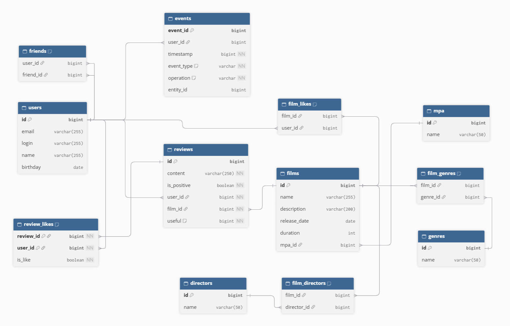

# Java Filmorate

**Java Filmorate** — командный учебный проект: REST API для сервиса, в котором пользователи могут находить фильмы, оценивать их, общаться с друзьями и получать персональные рекомендации.

Приложение позволяет вести каталог фильмов и пользователей, формировать рейтинги популярности по лайкам, искать фильмы по названию и режиссёру, публиковать отзывы и отслеживать события пользователей.


## Схема




## Функциональность

### Фильмы

- Добавление, получение, редактирование и удаление фильмов.
- Хранение информации о названии, описании, дате выхода, продолжительности, жанрах, режиссёрах и возрастном рейтинге MPA.
- Постановка и удаление лайков.
- Получение рейтинга популярных фильмов по количеству лайков с фильтрацией по жанру и году выпуска.
- Поиск фильмов по названию, имени режиссёра или одновременно по обоим параметрам; результаты упорядочиваются по популярности.
- Получение фильмов определённого режиссёра с сортировкой по году выхода или числу лайков.
- Получение фильмов, понравившихся двум пользователям.

### Пользователи и социальные функции

- Создание, получение, редактирование и удаление пользователей.
- Добавление и удаление друзей, просмотр списка друзей и поиск общих друзей.
- Персональные рекомендации фильмов на основе совпадений лайков с другим пользователем. Из фильмов наиболее похожего по предпочтениям пользователя выбираются те, которые текущий пользователь ещё не лайкнул.
- Просмотр ленты событий: добавление и удаление друзей, лайки фильмов и действия с отзывами.

### Отзывы

- Создание, изменение, удаление и получение отзывов на фильмы.
- Разделение отзывов на положительные и отрицательные.
- Лайки и дизлайки отзывов, возможность отмены реакции.
- Расчёт рейтинга полезности отзыва и сортировка отзывов по нему.

*В представленном исходном коде для отзывов показаны сервис и слой доступа к данным; маршруты их REST-контроллера в приложенном документе не приведены.*

### Справочники

- Получение списка жанров и отдельных жанров.
- Получение списка рейтингов MPA и отдельных рейтингов.
- Добавление, изменение, получение и удаление режиссёров.

## Технологии

- **Java** — язык реализации.
- **Spring Boot / Spring Web** — запуск приложения и создание REST API.
- **Spring JDBC (`JdbcTemplate`)** — выполнение SQL-запросов и работа с реляционной базой данных.
- **Maven** — сборка и управление зависимостями.
- **Lombok** — уменьшение шаблонного кода моделей и логирование.
- **Bean Validation** — проверка входных данных.
- **SQL** — хранение пользователей, фильмов и связей между ними.

## Архитектура

Код разделён на пакеты:

```text
src/main/java/ru/yandex/practicum/filmorate/
├── controller/   # REST-контроллеры и HTTP-эндпоинты
├── service/      # Бизнес-логика и взаимодействие компонентов
├── storage/      # Работа с БД через JdbcTemplate
├── model/        # Модели предметной области
└── exception/    # Обработка ошибок приложения
```

Основной поток обработки запроса: **HTTP-запрос → контроллер → сервис / хранилище → база данных → HTTP-ответ**. Часть контроллеров обращается непосредственно к хранилищам справочников.

В `src/main/resources` предусмотрены `schema.sql` и `data.sql` для структуры и начальных данных БД. В корне проекта находится `diagram.png` со схемой базы данных.

### Основные сущности

`User`, `Film`, `Genre`, `Mpa`, `Director`, `Review` и `Event`. Для связей между сущностями используются, в частности, таблицы друзей, лайков фильмов, жанров и режиссёров фильмов, а также реакций на отзывы.

## Основные API-эндпоинты

| Метод | Эндпоинт | Назначение |
|---|---|---|
| `GET` | `/films` | Получить все фильмы |
| `GET` | `/films/{id}` | Получить фильм по ID |
| `POST` | `/films` | Добавить фильм |
| `PUT` | `/films` | Обновить фильм |
| `DELETE` | `/films/{filmId}` | Удалить фильм |
| `PUT` / `DELETE` | `/films/{id}/like/{userId}` | Поставить / удалить лайк |
| `GET` | `/films/popular?count=10&genreId=1&year=2020` | Популярные фильмы; жанр и год необязательны |
| `GET` | `/films/search?query=...&by=title,director` | Поиск по названию и/или режиссёру |
| `GET` | `/films/director/{directorId}?sortBy=year` | Фильмы режиссёра; `sortBy=year` или `likes` |
| `GET` | `/films/common?userId=1&friendId=2` | Общие понравившиеся фильмы |
| `GET` / `POST` / `PUT` | `/users` | Получить, создать или обновить пользователей |
| `GET` / `DELETE` | `/users/{id}` | Получить или удалить пользователя |
| `PUT` / `DELETE` | `/users/{id}/friends/{friendId}` | Добавить или удалить друга |
| `GET` | `/users/{id}/friends` | Список друзей |
| `GET` | `/users/{id}/friends/common/{otherId}` | Общие друзья |
| `GET` | `/users/{id}/recommendations` | Рекомендации фильмов |
| `GET` | `/users/{id}/feed` | Лента событий |
| `GET` | `/genres`, `/genres/{id}` | Жанры |
| `GET` | `/mpa`, `/mpa/{id}` | Рейтинги MPA |
| `GET` / `POST` / `PUT` | `/directors` | Список, добавление и изменение режиссёров |
| `GET` / `DELETE` | `/directors/{id}` | Получение или удаление режиссёра |


### Пример запроса

```bash
curl -X POST http://localhost:8080/films \
  -H "Content-Type: application/json" \
  -d '{
    "name": "Inception",
    "description": "Фантастический триллер",
    "releaseDate": "2010-07-16",
    "duration": 148,
    "mpa": {"id": 1}
  }'
```

Идентификатор рейтинга MPA должен существовать в базе данных.

## Валидация и обработка ошибок

Для входных данных используются аннотации валидации и проверки бизнес-условий: например, дата выхода фильма не может быть раньше 28 декабря 1895 года, продолжительность должна быть положительной, а дата рождения пользователя — не в будущем.

Глобальный обработчик исключений возвращает HTTP-статусы `400 Bad Request`, `404 Not Found` и `500 Internal Server Error` с информацией об ошибке в JSON.

---

Проект выполнен в рамках командной практики разработки Java-приложений.
